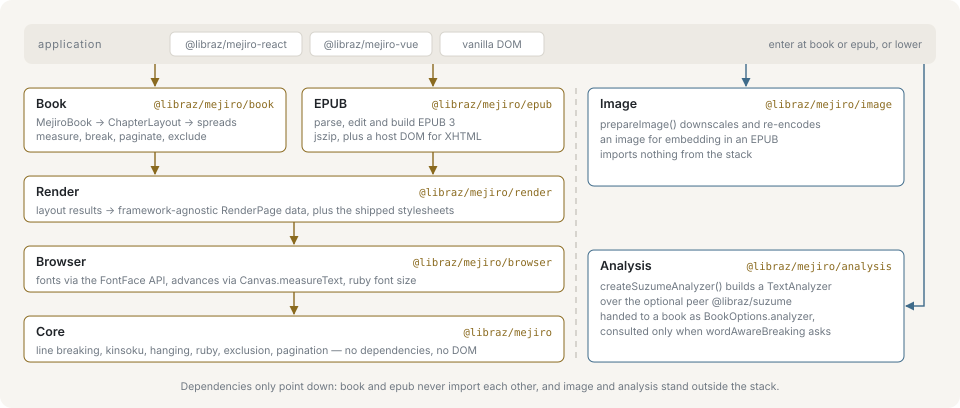
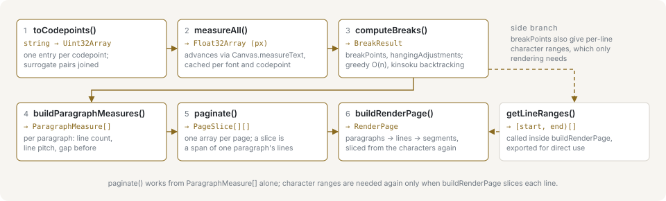

# Core Concepts

This document covers the fundamental architecture and design decisions behind mejiro.

## 1. Architecture Overview

mejiro is organized into layers, each with a clear responsibility. Higher layers depend on lower layers but never the reverse. `book` and `epub` are siblings -- both sit on `render`, and an application can enter at either one. `image` and `analysis` are independent of the rest.



### Book (`@libraz/mejiro/book`)

The high-level orchestration layer. `MejiroBook` manages font loading, character measurement, and layout in a single class. `ChapterLayout` handles pagination, spread generation, and image exclusion with lazy computation. This is the **recommended entry point** for most applications -- it eliminates the need to manually wire together the lower layers.

### Core (`@libraz/mejiro`)

The pure computation layer. Handles line breaking, kinsoku shori (line break prohibition rules), hanging punctuation, ruby preprocessing, and pagination. It operates entirely on typed arrays and has **zero external dependencies**. It requires no DOM, no Canvas, and no I/O -- the same code runs in Node.js, workers, and edge runtimes.

### Browser (`@libraz/mejiro/browser`)

Bridges the gap between the core engine's typed arrays and the browser's string-based APIs. Responsibilities include:

- **Font loading** via the FontFace API (`document.fonts.load`)
- **Character measurement** via `Canvas.measureText`, producing the `Float32Array` of advance widths that the core engine requires
- **Width caching** with a two-level `Map<fontSpec, Map<codepoint, width>>` so each character is measured at most once per font
- **Ruby font derivation** -- automatically computes the ruby font size (typically half the base font size)

### EPUB (`@libraz/mejiro/epub`)

Parses EPUB files and extracts text with inline annotations. The parsing pipeline follows the EPUB specification: ZIP -> `container.xml` -> OPF package document -> spine order -> XHTML content documents. Ruby annotations (`<ruby>` / `<rt>` elements) are extracted as `InlineAnnotation` entries with `type: 'ruby'`. Depends on `jszip` for ZIP extraction.

### Render (`@libraz/mejiro/render`)

Converts layout results into a framework-agnostic `RenderPage` data structure. This structure describes pages as a hierarchy of paragraphs, lines, and segments -- ready for any rendering framework to consume. Also provides `mejiro.css` with the base styles needed for vertical text display.

### Image (`@libraz/mejiro/image`)

A standalone browser helper. It imports nothing from the other layers except the core's `MejiroError`. `prepareImage()` decodes an image file, downscales it to fit pixel bounds, and re-encodes it under a byte budget so it is safe to embed in an EPUB.

### Analysis (`@libraz/mejiro/analysis`)

An optional helper outside the layer stack. `createSuzumeAnalyzer()` builds a `TextAnalyzer` backed by `@libraz/suzume`, an optional peer dependency, and passing it as `BookOptions.analyzer` (with `wordAwareBreaking` set above `'off'`) turns its findings into line-breaking hints. Without it, layout runs on the character-class rules alone.

## 2. TypedArray-Based API

mejiro represents text as `Uint32Array` (codepoints) and `Float32Array` (advance widths) rather than JavaScript strings and number arrays. This is a deliberate design choice.

### Why not strings?

JavaScript strings use UTF-16 encoding. Characters outside the Basic Multilingual Plane (BMP) -- such as CJK Extension B characters, emoji, and rare kanji -- are represented as **surrogate pairs**, meaning a single character occupies two positions in the string. This makes indexing unreliable: `str[i]` may return half of a character.

`Uint32Array` stores one Unicode codepoint per element regardless of whether the character is in the BMP or not. This gives consistent O(1) indexing over characters.

### Why Float32Array for advances?

Each element in the advances array corresponds to the measured advance width (in pixels) of the codepoint at the same index. `Float32Array` provides compact storage and avoids boxing overhead compared to a regular `number[]`.

### Conversion

The `toCodepoints()` function converts a JavaScript string to a `Uint32Array`:

```ts
import { toCodepoints } from '@libraz/mejiro';

const str = '𠮷野家'; // 𠮷 is a non-BMP character (U+20BB7)
str.length;           // 4 (UTF-16: surrogate pair + 2 chars)

const cps = toCodepoints(str);
cps.length;           // 3 (one codepoint per character)
cps[0];               // 0x20BB7
```

The typed array pair (`Uint32Array` for codepoints + `Float32Array` for advances) enables efficient sequential processing through the line breaking algorithm without any string allocation or surrogate pair handling.

## 3. Layout Pipeline

The full layout pipeline transforms a string into renderable page data in six steps:



`getLineRanges()` is a side branch: `buildRenderPage()` calls it internally to slice
characters per line, and it is exposed for consumers that need the ranges directly.
`paginate()` itself never sees line ranges — it works from `ParagraphMeasure[]`.

### Step 1: `toCodepoints()`

Converts a JavaScript string into a `Uint32Array` of Unicode codepoints. This normalizes surrogate pairs into single entries, giving a 1:1 mapping between array indices and characters.

### Step 2: `CharMeasurer.measureAll()`

Measures each codepoint's advance width using the browser's `Canvas.measureText` API. Returns a `Float32Array` where `advances[i]` is the width (in pixels) of `codepoints[i]`. Results are cached per font specification and codepoint so repeated characters are only measured once.

### Step 3: `computeBreaks()`

The core line breaking algorithm. Takes a `LayoutInput` (codepoints, advances, line width, and optional settings) and produces a `BreakResult` containing:

- `breakPoints` (`Uint32Array`) -- indices where lines break
- `hangingAdjustments` (`Float32Array`) -- overhang amount for hanging punctuation, one entry per line including the last
- `effectiveAdvances` (`Float32Array`) -- per-character advances after tate-chu-yoko collapsing and ruby width distribution (present when ruby or tate-chu-yoko annotations are provided)

The algorithm is **greedy O(n)** with backtracking limited to kinsoku rule resolution. See [Line Breaking](03-line-breaking.md) for details.

### Step 4: `buildParagraphMeasures()`

Turns render entries (characters, break points, annotations, heading level) into `ParagraphMeasure[]` -- per paragraph, its line count, line pitch in the block direction, and the gap before it. This is what pagination consumes; the character ranges themselves are not needed until rendering.

`getLineRanges(breakPoints, length)` converts the flat `breakPoints` array into `[start, end)` pairs. `buildRenderPage()` calls it internally, and it is exported for consumers that need the ranges directly -- it is not a step in the pagination path.

### Step 5: `paginate()`

Distributes lines across fixed-size pages. It takes exactly two arguments -- `paginate(pageBlockSize, paragraphs)`, where `pageBlockSize` is the available size in the block direction (the page width in vertical-rl) and `paragraphs` is the `ParagraphMeasure[]` from step 4 -- and returns `PageSlice[][]`: an array of pages, each containing slices of paragraphs. It always returns at least one page.

### Step 6: `buildRenderPage()`

Converts a `PageSlice[]` into a `RenderPage` structure: a tree of paragraphs, lines, and segments with all the positioning data a renderer needs. This is the final, framework-agnostic output that React, Vue, or vanilla DOM code consumes.

## 4. Determinism

mejiro's core is fully deterministic:

- **Same input, same output.** Given identical codepoints, advances, line width, and options, `computeBreaks` always produces the same break points.
- **No global state.** All computation depends solely on the function arguments. There are no module-level variables that affect output.
- **No randomness.** The greedy algorithm is entirely predictable.
- **Pure computation.** The core module (`@libraz/mejiro`) performs no DOM access, no Canvas calls, and no I/O. It is a pure function from typed arrays to typed arrays.

This makes the core suitable for use in workers, server-side rendering, snapshot testing, and any environment where reproducibility matters.

## 5. Vertical Text and CSS

Japanese vertical text layout is achieved through CSS `writing-mode: vertical-rl`, which makes text flow top-to-bottom with columns progressing right-to-left.

### How dimensions map

In vertical layout, the terminology shifts:

| Concept | Horizontal layout | Vertical layout |
|---|---|---|
| Inline direction | left to right | top to bottom |
| Block direction | top to bottom | right to left |
| `lineWidth` for mejiro | container **width** | container **height** |

The `lineWidth` parameter passed to `computeBreaks` corresponds to the **height** of the container element -- the inline dimension in vertical mode.

### Safety margin

There is a subtle discrepancy between `Canvas.measureText` (which returns horizontal advance widths) and the actual vertical advance used by the browser's CSS layout engine. Over a full column of ~40 characters, this difference can accumulate and cause overflow.

The `verticalLineWidth()` function compensates by subtracting a safety margin proportional to the font size:

```ts
verticalLineWidth(containerHeight, fontSize)
// returns containerHeight - fontSize * 0.5
```

Always use `verticalLineWidth()` (or `MejiroBrowser.verticalLineWidth()`) to compute the `lineWidth` for vertical text. Passing `containerHeight` directly will likely cause column overflow.

### CSS setup

The `mejiro.css` stylesheet (provided by `@libraz/mejiro/render`) sets up the required CSS properties. The `mejiro-page` class applies `writing-mode: vertical-rl` along with other properties needed for correct vertical rendering.

## 6. API Conventions

The rules below hold across every subpath and both framework packages, so a rule learned in one place applies everywhere.

### Errors

- An argument of the wrong type or out of range is a programming error and throws `TypeError` or `RangeError`, with a message that says what to fix. So does an id the library handed out (a block id, an asset key, a chapter index) that no longer exists.
- Every other failure is a `MejiroError`: `class MejiroError extends Error`, `name` `'MejiroError'`, a readonly `code: MejiroErrorCode`, and the underlying error as `cause` when there is one. Every subpath and both framework packages re-export the same class, so one `instanceof MejiroError` check covers them all. Branch on `code`, never on `message`.
- An aborted operation rejects with its `signal.reason` (an `AbortError` `DOMException` unless the caller supplied a reason). A signal that is already aborted at the call rejects after the first `await`, and no callback (`onProgress` and the like) runs once the signal has fired.
- A degradation the operation survived is reported in a `warnings: readonly MejiroWarning[]` list, each entry `{ code: MejiroWarningCode; message: string }`.
- The library writes nothing to the console on its own. A failure it recovers from goes to an `onError` callback; only when none is given does it fall back to `console.warn`.
- The React and Vue packages pass a `MejiroError` through as it is. A `subscribe` listener that throws does not stop delivery to the other listeners; its error is rethrown on a microtask.

`MejiroErrorCode` grows in minor releases. A `switch` over it keeps a `default` branch.

| `code` | Raised when | Entry points |
|---|---|---|
| `epub-invalid-archive` | The input is not a ZIP archive an EPUB can live in (an empty or one-byte input included) | `mejiro/epub`, React, Vue |
| `epub-invalid-package` | The container, package document or a chapter is malformed, no chapter is readable, or a project with no chapters is exported | `mejiro/epub`, React, Vue |
| `epub-limit-exceeded` | The archive passes one of the parse limits | `mejiro/epub`, React, Vue |
| `epub-unsupported-content` | An edited chapter holds content the exporter cannot write back without losing it | `mejiro/epub`, React, Vue |
| `dom-unavailable` | `DOMParser` or another required DOM API is missing | `mejiro/epub` |
| `environment-unsupported` | `createImageBitmap`, canvas or the FontFace API is missing | `mejiro/image`, `mejiro/browser` |
| `font-unavailable` | The font measures like the fallback under `strictFontCheck`, or the canvas rejects the font specification | `mejiro/browser`, `mejiro/book`, React, Vue |
| `font-load-failed` | Loading a font face failed | `mejiro/browser`, `mejiro/book`, React, Vue |
| `page-size-unset` | A chapter is laid out before a page size is set | `mejiro/book` |
| `fetch-failed` | Fetching an EPUB by URL returned a failure status | React, Vue |
| `asset-fetch-failed` | Fetching an image asset at export time returned a failure status | `mejiro/epub`, React, Vue |
| `analyzer-unavailable` | `@libraz/suzume` is not installed or its module fails to load | `mejiro/analysis` |
| `analyzer-disposed` | An analyzer is used after `dispose()` | `mejiro/analysis` |
| `analyzer-failed` | The analyzer threw while a chapter was laid out (reported through `onError`) | `mejiro/book`, React, Vue |
| `image-decode-failed` | The image cannot be decoded | `mejiro/image` |
| `image-encode-failed` | The prepared image cannot be encoded | `mejiro/image` |
| `storage-read-failed` / `storage-write-failed` | The persistence storage threw | React, Vue |
| `storage-corrupt` | Stored data cannot be read back | React, Vue |
| `snapshot-invalid` | A layout snapshot is malformed or of an unknown version | `mejiro/book` |
| `regex-unsafe` | A search pattern is rejected as unsafe to evaluate | `mejiro/book` |

The warning codes are `alignment-failed` and `morphemes-dropped` (analyzer output that did not line up with the text) and `max-bytes-exceeded` (`prepareImage` could not bring the image under `maxBytes`).

### Names

- A position is `xxxIndex` and a count is `xxxCount`: `chapterIndex`, `spreadIndex`, `pageCount`. A bare `index` / `count` appears only on an object that is itself the sequence (`useSpread`, `MejiroPageIndicator`). Every index is zero-based.
- A rectangle is `{ x, y, width, height }`.
- A code point range is `startIndex` / `endIndex`; a UTF-16 range is `startOffset` / `endOffset`. `start` / `end` are kept for ranges between two anchors (`Annotation`, `AnchorRange`).
- A time is in milliseconds, and its name says so: `debounceMs`, `resizeDebounceMs`, `turnDurationMs`.
- `book` holds a `MejiroBook`, `epub` holds EPUB data (`EpubBook`, `EditableEpubBook`), and `editor` holds an `EditableEpub`.
- `default*` is the value a newly created element gets (`defaultChapterTitle`, `defaultWidth`); a hook's starting state is `initialXxx`.
- A change notification is `onXxxChange(next)` in React and `update:xxx` in Vue, where `xxx` is the prop or state it reports. A pick from a list the component does not hold as state is `onXxxSelect(item)` (Vue: `xxx-select`).
- `updateXxx(patch)` merges; `setXxx(value)` replaces.
- The kinsoku setting is `kinsoku` everywhere: a `KinsokuMode`, or custom `KinsokuRules` where the API accepts them.
- A chrome toggle is `showXxx`; `enableXxx` switches a behaviour (`enableHanging`, `enableKeyboard`).

### Absent values

A search or lookup that finds nothing returns `null`. A Map-like `get` (`WidthCache.get`) returns `undefined`, as `Map` does. A builder whose result feeds an optional input field (`buildTcyAnnotations`, `mergeClusterIds`) returns `undefined`. An explicit clear argument is `null` (`setImageCaption(chapterIndex, blockId, null)`).

### Arguments

A call names its target with at most two positional arguments that form a well-known pair — `(chapterIndex, blockId)`, `(chapterIndex, index)` for an insert position, `(text, pos)`, `(left, right)` — or one subject (`(layout)`, `(book)`), followed by at most one payload or options object. There are no optional positional arguments and no positional booleans, with one exception: a trailing optional address that switches between all and one (`clearImages(spreadIndex?)`, `clearOverlays(spreadIndex?)`, `clearCache(fontSpec?)`).

### Types

Public parameters, return values and props have named types; no anonymous object type appears in a signature. Array inputs are `readonly`. A default is stated with `@defaultValue`. Combinations that cannot be valid are excluded by discriminated unions (`NewParagraph`, `ParagraphPatch`, the `MejiroReader` source props). The published declarations carry no `any` of their own.

### Bytes

Byte input is `BinaryInput` (`ArrayBuffer | Uint8Array`). A `Uint8Array` is read within its view (`byteOffset`, `byteLength`), never through its whole `.buffer`, and the input is neither kept nor modified. Byte output is a `Uint8Array`. Entry points that take a browser file (`prepareImage(file)`) accept `Blob | File` as they are.

### Cancellation

`parseEpub`, `parseEditableEpub`, `EditableEpub.export`, `EpubProject.export` and `prepareImage` take `signal?: AbortSignal`, and the reader's and hooks' `fetchEpub(url, { signal })` callback receives one. Creating an analyzer and loading a font cannot be interrupted, so they take no signal; a hook discards their result instead. A hook aborts its previous load when a new one starts and when it unmounts.

### Lifecycle

Resources are released with `dispose()`, which is idempotent. The first line of its documentation says whether the object stays usable afterwards; only `TextAnalyzer` is terminal, because it releases a WebAssembly instance. Change subscriptions are `subscribe(listener: () => void): () => void`: the listener receives no payload and reads what it needs from the object (`MejiroBook`, `EditableEpub`).

### Mutations

A mutator that creates an element returns the element it stored (`EditableEpub.insertParagraph` returns the block, `EpubProject.addChapter` the stored chapter). A mutator that keeps the object it was given returns `void` (`ExclusionEngine.addImage`, whose `removeImage` then works by reference). Calls do not chain. `ChapterLayout.setImages` returns the reflowed `SpreadResult`, because the caller needs it next and nothing new was created.

### React and Vue

The two packages use the same prop, event and return-key names. A React `onXxxChange` is the Vue `update:xxx` event (`v-model:xxx`); any other React `onXxx` notification is the Vue event `xxx` in kebab-case, emitted with a typed payload. An event on the reader's `subscribe()` is the prop name without `on`, in camelCase (`onChapterFinished` → `chapterFinished`; Vue emits `chapter-finished`). Vue inputs take `MaybeRefOrGetter<T>` and return managed state as readonly refs. React low-level components forward a `ref` and accept the root element's `div` attributes.

A value prop is the starting value; the component becomes controlled for it only when the matching handler is passed (React: `onXxxChange` is present; Vue: the parent listens to `update:xxx`). This departs from the common convention that pairs `value` with `onChange` for controlled use and `defaultValue` for uncontrolled use, and treats mixing them as a mistake. It lets a host that edits, say, the title on another screen opt into control without breaking the uncontrolled default, and keeps a single prop name per value.

### Documentation

The JSDoc and these pages describe the current contract. [Migrating to 0.11](11-migrating-to-0.11.md) is the one page that compares versions.

---

Next: [Line Breaking](03-line-breaking.md) -- the `computeBreaks` algorithm, kinsoku shori, and hanging punctuation.

[Back to documentation index](README.md)
