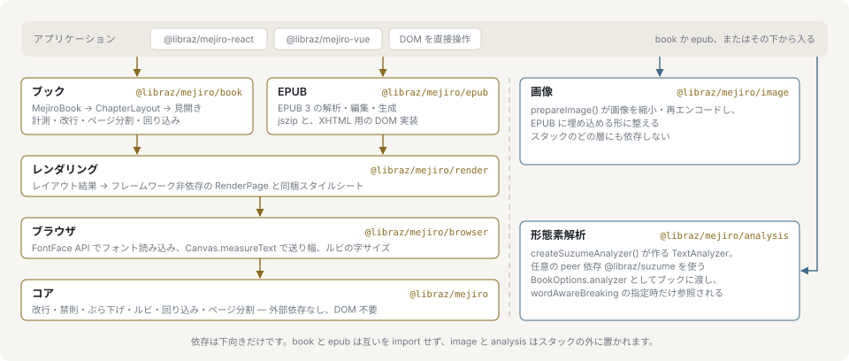
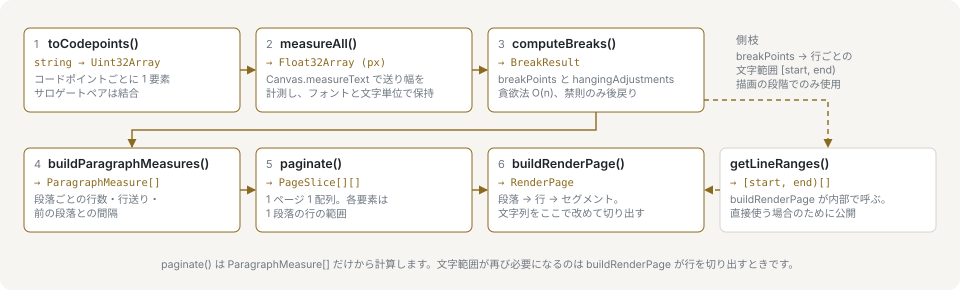

# コアコンセプト

このページでは、mejiro の基本的な構成と、設計上の考え方を説明します。

## 1. アーキテクチャ概要

mejiro はいくつかのレイヤーに分かれています。上位レイヤーは下位レイヤーを利用しますが、下位レイヤーは上位レイヤーに依存しません。必要な深さの API だけを選んで使えるようにするためです。`book` と `epub` は同じ段にある兄弟で、どちらも `render` の上に乗ります。アプリケーションはどちらからでも入れます。`image` と `analysis` は他のレイヤーから独立しています。



### ブック (`@libraz/mejiro/book`)

ほとんどのアプリケーションで最初に使う入口です。`MejiroBook` はフォント読み込み、文字計測、レイアウトをまとめて管理します。`ChapterLayout` はページ分割、見開きの取得、画像回り込みを遅延計算します。下位レイヤーを自分でつなぎ込む必要がないため、通常はこの API から始めるのがおすすめです。

### コア (`@libraz/mejiro`)

純粋な計算だけを行うレイヤーです。改行処理、禁則処理、ぶら下げ、ルビの前処理、ページ分割を担当します。処理は TypedArray 上で行われ、**外部依存はありません**。DOM、Canvas、I/O を使わないため、Node.js、Web Worker、エッジランタイムでも同じコードを動かせます。

### ブラウザ (`@libraz/mejiro/browser`)

コアエンジンが必要とする TypedArray と、ブラウザの文字列ベース API の間をつなぐレイヤーです。主な役割は次のとおりです。

- FontFace API（`document.fonts.load`）による**フォント読み込み**
- `Canvas.measureText` による**文字幅計測**。コアエンジンへ渡す `Float32Array` の送り幅データを作ります
- 二階層の `Map<fontSpec, Map<codepoint, width>>` による**幅キャッシュ**。同じ文字はフォントごとに最大 1 回だけ計測されます
- **ルビフォントサイズの自動算出**。通常は本文フォントサイズの半分を使います

### EPUB (`@libraz/mejiro/epub`)

EPUB ファイルを解析し、本文とインライン注釈を取り出します。処理の流れは EPUB 仕様に沿っており、ZIP → `container.xml` → OPF パッケージドキュメント → spine 順 → XHTML コンテンツドキュメントの順にたどります。`<ruby>` / `<rt>` 要素は `type: 'ruby'` の `InlineAnnotation` として抽出されます。ZIP 展開には `jszip` を使います。

### レンダリング (`@libraz/mejiro/render`)

レイアウト結果を、React や Vue に依存しない `RenderPage` データ構造へ変換します。`RenderPage` はページを段落、行、セグメントの階層で表します。縦書き表示に必要な基本スタイルを含む `mejiro.css` もここに含まれます。

### 画像 (`@libraz/mejiro/image`)

ブラウザ向けの補助レイヤーです。他のレイヤーから import するのはコアの `MejiroError` だけです。`prepareImage()` は画像ファイルをデコードし、指定のピクセル上限に収まるよう縮小し、バイト数の上限内に収まるよう再エンコードします。EPUB に埋め込む前処理として使います。

### 形態素解析 (`@libraz/mejiro/analysis`)

レイヤー構成の外にある任意の補助機能です。`createSuzumeAnalyzer()` は、任意の peer 依存である `@libraz/suzume` を使う `TextAnalyzer` を作ります。これを `BookOptions.analyzer` に渡し、`wordAwareBreaking` を `'off'` 以外にすると、解析結果が改行位置のヒントとして使われます。使わない場合は、文字種の規則だけで改行を決めます。

## 2. TypedArrayベースAPI

mejiro は、レイアウト計算中のテキストを JavaScript 文字列や `number[]` ではなく、`Uint32Array`（コードポイント）と `Float32Array`（送り幅）で扱います。これは意図的な設計です。

### なぜ文字列を使わないのか?

JavaScript 文字列は UTF-16 です。BMP 外の文字（CJK 拡張 B、絵文字、希少漢字など）は**サロゲートペア**として表現され、1 文字が文字列内の 2 つの位置を占めます。そのため、`str[i]` が文字の半分だけを返すことがあります。

`Uint32Array` なら、BMP 内外に関係なく 1 要素に 1 つの Unicode コードポイントを格納できます。これにより、文字単位のインデックスアクセスを安定して扱えます。

### なぜFloat32Arrayを使うのか?

送り幅配列の各要素は、同じインデックスにあるコードポイントの幅（px）に対応します。`Float32Array` は `number[]` よりコンパクトで、ボクシングのオーバーヘッドも避けられます。

### 変換

`toCodepoints()`関数はJavaScript文字列を`Uint32Array`に変換します:

```ts
import { toCodepoints } from '@libraz/mejiro';

const str = '𠮷野家'; // 𠮷はBMP外の文字 (U+20BB7)
str.length;           // 4 (UTF-16: サロゲートペア + 2文字)

const cps = toCodepoints(str);
cps.length;           // 3 (1文字につき1コードポイント)
cps[0];               // 0x20BB7
```

型付き配列のペア（コードポイント用の`Uint32Array` + 送り幅用の`Float32Array`）により、文字列のアロケーションやサロゲートペアの処理なしに、改行アルゴリズムを効率的に逐次処理できます。

## 3. レイアウトパイプライン

レイアウト全体の流れは、文字列を表示用のページデータへ変換する 6 つのステップです。



`getLineRanges()` は本流ではなく側枝です。`buildRenderPage()` が行ごとの文字を切り出すために内部で呼び出しており、行範囲を直接必要とする利用者向けに公開されています。`paginate()` は行範囲を受け取らず、`ParagraphMeasure[]` だけから計算します。

### ステップ1: `toCodepoints()`

JavaScript文字列をUnicodeコードポイントの`Uint32Array`に変換します。サロゲートペアを単一のエントリに正規化し、配列インデックスと文字の1:1対応を実現します。

### ステップ2: `CharMeasurer.measureAll()`

ブラウザの`Canvas.measureText` APIを使用して各コードポイントの送り幅を計測します。`advances[i]`が`codepoints[i]`の幅（ピクセル単位）となる`Float32Array`を返します。結果はフォント指定とコードポイントごとにキャッシュされるため、繰り返し出現する文字は1回だけ計測されます。

### ステップ3: `computeBreaks()`

コアの改行アルゴリズムです。`LayoutInput`（コードポイント、送り幅、行幅、およびオプション設定）を受け取り、以下を含む`BreakResult`を生成します:

- `breakPoints` (`Uint32Array`) -- 行が折り返されるインデックス
- `hangingAdjustments` (`Float32Array`) -- ぶら下げ組みによるはみ出し量。最終行を含め、行ごとに 1 要素
- `effectiveAdvances` (`Float32Array`) -- 縦中横による幅の圧縮とルビの幅分配を反映した文字ごとの送り幅（ルビ注釈または縦中横注釈が指定された場合に存在）

アルゴリズムは禁則処理の解決に限定されたバックトラッキングを伴う**貪欲法O(n)**です。詳細は[改行処理](03-line-breaking.md)を参照してください。

### ステップ4: `buildParagraphMeasures()`

レンダーエントリ（文字・改行位置・注釈・見出しレベル）を `ParagraphMeasure[]` に変換します。段落ごとの行数、ブロック方向の行ピッチ、段落前の間隔が入ります。ページ分割が参照するのはこのデータで、文字範囲そのものは描画まで必要になりません。

`getLineRanges(breakPoints, length)` はフラットな `breakPoints` 配列を `[start, end)` ペアに変換します。`buildRenderPage()` が内部で呼び出しており、行範囲を直接必要とする利用者向けにも公開されていますが、ページ分割の経路には含まれません。

### ステップ5: `paginate()`

行を固定サイズのページに配置します。引数は 2 つだけで、`paginate(pageBlockSize, paragraphs)` の形です（`pageBlockSize` はブロック方向に使えるサイズ＝縦組みではページ幅、`paragraphs` はステップ4 の `ParagraphMeasure[]`）。戻り値は `PageSlice[][]` で、ページの配列の各要素が段落のスライスを含みます。どのような入力でも最低 1 ページを返します。

### ステップ6: `buildRenderPage()`

`PageSlice[]` を `RenderPage` 構造に変換します。段落、行、セグメントのツリーとして、表示に必要なデータを持ちます。React、Vue、vanilla DOM から扱う最終的な出力です。

## 4. 決定性

mejiro のコアは決定的に動作します。

- **同じ入力には同じ出力。** 同一のコードポイント、送り幅、行幅、オプションが与えられれば、`computeBreaks`は常に同じ改行位置を生成します。
- **グローバル状態なし。** すべての計算は関数の引数のみに依存します。出力に影響するモジュールレベルの変数は存在しません。
- **ランダム性なし。** 貪欲法アルゴリズムは完全に予測可能です。
- **純粋な計算。** コアモジュール（`@libraz/mejiro`）はDOMアクセス、Canvas呼び出し、I/Oを一切行いません。型付き配列から型付き配列への純粋関数です。

この性質により、Web Worker、SSR、スナップショットテストなど、再現性が重要な環境でも使いやすくなっています。

## 5. 縦書きとCSS

日本語の縦書き表示には CSS の `writing-mode: vertical-rl` を使います。テキストは上から下へ流れ、段は右から左へ進みます。

### 寸法の対応関係

縦書きレイアウトでは、用語の対応が変わります:

| 概念 | 横書きレイアウト | 縦書きレイアウト |
|---|---|---|
| インライン方向 | 左から右 | 上から下 |
| ブロック方向 | 上から下 | 右から左 |
| mejiroの`lineWidth` | コンテナの**幅** | コンテナの**高さ** |

`computeBreaks`に渡す`lineWidth`パラメータは、コンテナ要素の**高さ** -- 縦書きモードにおけるインライン方向の寸法 -- に対応します。

### セーフティマージン

`Canvas.measureText`（水平方向の送り幅を返す）とブラウザのCSSレイアウトエンジンが使用する実際の縦方向の送り幅との間には、微妙な不一致があります。約40文字の1段分にわたって、この差が蓄積しオーバーフローを引き起こす可能性があります。

`verticalLineWidth()`関数は、フォントサイズに比例したセーフティマージンを差し引くことで補正します:

```ts
verticalLineWidth(containerHeight, fontSize)
// containerHeight - fontSize * 0.5 を返す
```

縦書きテキストの`lineWidth`の計算には、常に`verticalLineWidth()`（または`MejiroBrowser.verticalLineWidth()`）を使用してください。`containerHeight`を直接渡すと、段のオーバーフローが発生する可能性が高くなります。

### CSSの設定

`mejiro.css`スタイルシート（`@libraz/mejiro/render`が提供）は、必要なCSSプロパティを設定します。`mejiro-page`クラスは`writing-mode: vertical-rl`およびその他の縦書きレンダリングに必要なプロパティを適用します。

## 6. API の規約

以下の規則はすべてのサブパスと両フレームワークパッケージに共通です。1 か所で覚えた規則がどこでも通用します。

### エラー

- 引数の型や範囲の誤りはプログラマの誤りとして `TypeError` か `RangeError` を投げ、メッセージには何をどう直すかを書きます。ライブラリ自身が返した id（ブロック id、資産キー、章の添字）が存在しない場合も同じです。
- それ以外の失敗はすべて `MejiroError` です。`class MejiroError extends Error` で、`name` は `'MejiroError'`、読み取り専用の `code: MejiroErrorCode` を持ち、元になったエラーがあれば `cause` に入ります。すべてのサブパスと両フレームワークパッケージが同じクラスを再エクスポートしているので、`instanceof MejiroError` の判定 1 つで足ります。分岐には `message` ではなく `code` を使ってください。
- 中断した操作は `signal.reason`（呼び出し側が理由を渡さなければ `AbortError` の `DOMException`）で reject します。呼び出し時点ですでに中断済みのシグナルは最初の `await` の後に reject し、シグナルが発火した後はコールバック（`onProgress` など）を呼びません。
- 操作は完了したが品質が落ちた場合は、`warnings: readonly MejiroWarning[]` で報告します。各要素は `{ code: MejiroWarningCode; message: string }` です。
- ライブラリは自分からコンソールに出力しません。回復できた失敗は `onError` コールバックに渡し、それが指定されていないときに限り `console.warn` に出します。
- React と Vue のパッケージは `MejiroError` をそのまま渡します。`subscribe` のリスナーが例外を投げても他のリスナーへの配送は続き、その例外はマイクロタスクで投げ直されます。

`MejiroErrorCode` はマイナーリリースで増えます。`switch` で分岐するときは `default` を置いてください。

| `code` | 発生する場面 | 入口 |
|---|---|---|
| `epub-invalid-archive` | 入力が EPUB を入れられる ZIP アーカイブでない（空や 1 バイトの入力を含む） | `mejiro/epub`、React、Vue |
| `epub-invalid-package` | コンテナ・パッケージ文書・章が不正、読める章がない、または章のないプロジェクトを書き出した | `mejiro/epub`、React、Vue |
| `epub-limit-exceeded` | アーカイブが解析の上限を超えた | `mejiro/epub`、React、Vue |
| `epub-unsupported-content` | 編集した章に、失わずには書き戻せない内容がある | `mejiro/epub`、React、Vue |
| `dom-unavailable` | `DOMParser` などの必要な DOM API がない | `mejiro/epub` |
| `environment-unsupported` | `createImageBitmap`、canvas、FontFace API がない | `mejiro/image`、`mejiro/browser` |
| `font-unavailable` | `strictFontCheck` のもとでフォントが代替フォントと同じ幅に計測された、または canvas がフォント指定を拒否した | `mejiro/browser`、`mejiro/book`、React、Vue |
| `font-load-failed` | フォントフェイスの読み込みに失敗した | `mejiro/browser`、`mejiro/book`、React、Vue |
| `page-size-unset` | ページサイズを設定する前に章をレイアウトした | `mejiro/book` |
| `fetch-failed` | URL からの EPUB の取得が失敗のステータスを返した | React、Vue |
| `asset-fetch-failed` | 書き出し時の画像資産の取得が失敗のステータスを返した | `mejiro/epub`、React、Vue |
| `analyzer-unavailable` | `@libraz/suzume` が未インストール、またはモジュールの読み込みに失敗した | `mejiro/analysis` |
| `analyzer-disposed` | `dispose()` 後に解析器を使った | `mejiro/analysis` |
| `analyzer-failed` | 章のレイアウト中に解析器が例外を投げた（`onError` で報告） | `mejiro/book`、React、Vue |
| `image-decode-failed` | 画像をデコードできない | `mejiro/image` |
| `image-encode-failed` | 処理した画像をエンコードできない | `mejiro/image` |
| `storage-read-failed` / `storage-write-failed` | 永続化のストレージが例外を投げた | React、Vue |
| `storage-corrupt` | 保存したデータを読み戻せない | React、Vue |
| `snapshot-invalid` | レイアウトのスナップショットが不正、または未知のバージョン | `mejiro/book` |
| `regex-unsafe` | 検索パターンが評価するには危険として拒否された | `mejiro/book` |

警告のコードは `alignment-failed` と `morphemes-dropped`（解析器の出力がテキストと整列できなかった）、`max-bytes-exceeded`（`prepareImage` が画像を `maxBytes` に収められなかった）です。

### 名前

- 位置は `xxxIndex`、件数は `xxxCount` です（`chapterIndex`、`spreadIndex`、`pageCount`）。`index` / `count` を単独で使うのは、オブジェクト自体が列であるとき（`useSpread`、`MejiroPageIndicator`）だけです。添字はすべて 0 始まりです。
- 矩形は `{ x, y, width, height }` です。
- コードポイントの範囲は `startIndex` / `endIndex`、UTF-16 の範囲は `startOffset` / `endOffset` です。`start` / `end` は 2 つのアンカーの間の範囲（`Annotation`、`AnchorRange`）にだけ使います。
- 時間はミリ秒で、名前に単位を含めます（`debounceMs`、`resizeDebounceMs`、`turnDurationMs`）。
- `book` は `MejiroBook`、`epub` は EPUB のデータ（`EpubBook`、`EditableEpubBook`）、`editor` は `EditableEpub` を入れる名前です。
- `default*` は新しく作る要素に入れる値（`defaultChapterTitle`、`defaultWidth`）で、フックの初期状態は `initialXxx` です。
- 変更通知は React では `onXxxChange(next)`、Vue では `update:xxx` で、`xxx` は通知する prop や状態の名前です。コンポーネントが状態として持たない一覧からの選択は `onXxxSelect(item)`（Vue: `xxx-select`）です。
- `updateXxx(patch)` はマージし、`setXxx(value)` は置き換えます。
- 禁則の設定はどこでも `kinsoku` です。`KinsokuMode` か、API が受け付ける場所ではカスタムの `KinsokuRules` を渡します。
- クロムの表示切り替えは `showXxx`、振る舞いの切り替えは `enableXxx`（`enableHanging`、`enableKeyboard`）です。

### 値がないとき

検索や参照で見つからなければ `null` を返します。Map と同じ形の `get`（`WidthCache.get`）は `Map` と同じく `undefined` を返します。結果を省略可能な入力フィールドへそのまま渡すための関数（`buildTcyAnnotations`、`mergeClusterIds`）は `undefined` を返します。明示的に消す引数は `null` です（`setImageCaption(chapterIndex, blockId, null)`）。

### 引数

呼び出しの対象は、よく知られた組の位置引数 2 つまで（`(chapterIndex, blockId)`、挿入位置の `(chapterIndex, index)`、`(text, pos)`、`(left, right)`）か、主語 1 つ（`(layout)`、`(book)`）で指定し、その後にペイロードかオプションのオブジェクトを最大 1 つ取ります。省略可能な位置引数と位置引数の真偽値は作りません。例外は 1 つで、全体と個別を切り替える末尾の省略可能な番地（`clearImages(spreadIndex?)`、`clearOverlays(spreadIndex?)`、`clearCache(fontSpec?)`）です。

### 型

公開の引数・戻り値・props には名前付きの型を使い、シグネチャに匿名のオブジェクト型は出しません。配列の入力は `readonly` です。既定値は `@defaultValue` で示します。ありえない組み合わせは判別共用体で型から外します（`NewParagraph`、`ParagraphPatch`、`MejiroReader` のソース props）。公開する型宣言は独自の `any` を持ちません。

### バイト列

バイト列の入力は `BinaryInput`（`ArrayBuffer | Uint8Array`）です。`Uint8Array` はそのビューの範囲（`byteOffset`、`byteLength`）だけを読み、`.buffer` 全体は読みません。入力は保持も変更もしません。バイト列の出力は `Uint8Array` です。ブラウザのファイルを受け取る入口（`prepareImage(file)`）は `Blob | File` をそのまま受け付けます。

### 中断

`parseEpub`、`parseEditableEpub`、`EditableEpub.export`、`EpubProject.export`、`prepareImage` は `signal?: AbortSignal` を取り、リーダーとフックの `fetchEpub(url, { signal })` コールバックにもシグナルが渡ります。解析器の作成とフォントの読み込みは途中で止める手段がないのでシグナルを取らず、フックがその結果を捨てます。フックは、新しい読み込みが始まったときとアンマウント時に前回の読み込みを中断します。

### ライフサイクル

資源の解放は `dispose()` で、何度呼んでもかまいません。解放後も使えるかどうかは、そのドキュメントの 1 行目に書いてあります。終端なのは `TextAnalyzer` だけで、WebAssembly インスタンスを解放するためです。変更の購読は `subscribe(listener: () => void): () => void` です。リスナーは引数を受け取らず、必要な値はオブジェクト（`MejiroBook`、`EditableEpub`）から読みます。

### 変更操作

要素を作るメソッドは保存した要素を返します（`EditableEpub.insertParagraph` はブロックを、`EpubProject.addChapter` は保存した章を返す）。渡されたオブジェクトをそのまま保持するメソッドは `void` を返します（`ExclusionEngine.addImage`。対になる `removeImage` は参照で照合する）。メソッドチェーンはありません。`ChapterLayout.setImages` は流し直した `SpreadResult` を返します。呼び出し側が次に必ず使う値で、作った要素がないためです。

### React と Vue

2 つのパッケージは同じ prop・イベント・戻り値のキー名を使います。React の `onXxxChange` は Vue の `update:xxx` イベント（`v-model:xxx`）で、それ以外の React の `onXxx` 通知は kebab-case の Vue イベント `xxx` になり、ペイロードは型付きで emit されます。リーダーの `subscribe()` のイベント名は prop 名から `on` を除いた camelCase です（`onChapterFinished` → `chapterFinished`。Vue の emit は `chapter-finished`）。Vue の入力は `MaybeRefOrGetter<T>` を取り、管理する状態は読み取り専用の ref で返します。React の低レベルコンポーネントは `ref` を転送し、ルート要素の `div` 属性を受け取ります。

値の prop は開始値です。対応するハンドラを渡したときだけ、コンポーネントはその値について controlled になります（React: `onXxxChange` があるとき、Vue: 親が `update:xxx` を購読しているとき）。これは、`value` と `onChange` の組で controlled、`defaultValue` で uncontrolled とし、両者の混在を誤用とする一般的な慣習とは異なります。たとえばタイトルを別の画面で編集するホストが、uncontrolled の既定を壊さずに controlled を選べるようにするためで、値ごとの prop 名も 1 つで済みます。

### ドキュメント

JSDoc とこれらのページは現在の契約だけを書きます。バージョン間を比べるのは [0.11 への移行](11-migrating-to-0.11.md) のページだけです。

---

次へ: [改行処理](03-line-breaking.md) -- `computeBreaks`アルゴリズム、禁則処理、ぶら下げ組み。

[ドキュメント目次に戻る](README.md)
